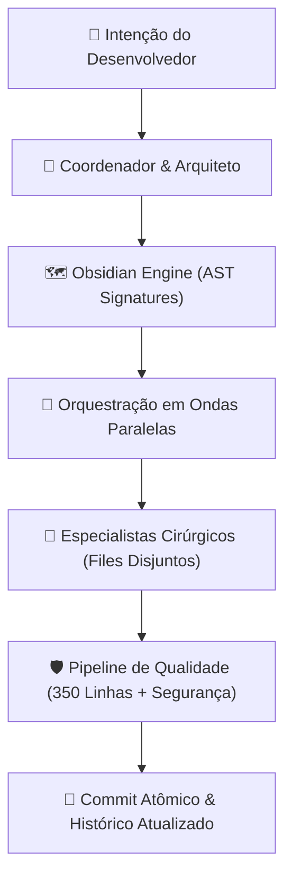

# ⚡ Vibe Engineering Toolkit

**O Mega Toolkit de Engenharia de Agentes, Economia Estrita de Tokens e Quality Gates para Vibe Coding de Alta Performance.**

Um sistema integrado que une o poder dos **Agentes Especialistas**, a economia extrema de tokens do **Obsidian Engine** e as convenções matemáticas de **Orquestração em Ondas Paralelas** e **Quality Gates** em um único repositório portátil.

Projetado para rodar com **Claude Code**, **Google Antigravity / Gemini**, **OpenAI Codex** e **OmniRoute Gateway**.

---

## 🏛️ Os 4 Pilares da Engenharia Vibe



### 1. 🧠 Obsidian Engine (Economia de Tokens a Custo Zero)
- **Geração de Codemap Nativa:** Script nativo em Node.js (`codemap_generator.js`) com 0 dependências externas que extrai assinaturas AST de classes, funções, interfaces, types e componentes React (`FC`, `memo`, `forwardRef`, `default exports`).
- **Leitura Cirúrgica de Linhas:** Os agentes nunca varrem a base de código do zero. Eles consultam o `tree-signatures.md` e lêem apenas os blocos de linhas exatos afetados via offsets.
- **Cofre Isolado:** A pasta `.memory/` é automaticamente registrada em `.git/info/exclude`. Seu repositório no GitHub permanece 100% limpo, sem subir lixo de contexto para o time.

### 2. 🌊 Orquestração em Ondas Paralelas (Parallel Wave Dispatch)
- **Eliminação de Colisão de Arquivos:** Subagentes paralelos só são disparados na mesma onda se o conjunto de arquivos for estritamente disjunto:
  $$\text{Files}(T_A) \cap \text{Files}(T_B) = \emptyset$$
- **Prevenção de Race Conditions:** Subagentes implementadores **nunca commitam** por conta própria. Eles realizam as alterações na working tree e reportam. Apenas o agente coordenador efetua commits atômicos capturando o `HEAD` fresco.
- **Fail-Safe Automático:** Se o escopo de arquivos de uma tarefa for genérico ou ambíguo, a execução degrada de forma segura para uma onda sequencial isolada.

### 3. 📏 Quality Gates Rígidos & Regra de Ouro das 350 Linhas
- **Limite Máximo de 350 Linhas por Arquivo:** Força modularização real. Nenhum arquivo monstro é permitido.
  - Lógica de estado e mutações $\rightarrow$ **Custom Hooks** (`use<Feature>.ts`).
  - Blocos visuais específicos $\rightarrow$ **Sub-componentes UI** em `components/`.
  - Consultas e chamadas de dados $\rightarrow$ **Services / Repositories**.
- **Isolamento de Camadas (UI vs DB):** Componentes de interface visual nunca rodam queries de banco nem importam clientes SQL diretamente.
- **Tolerância Zero a Warnings:** Burndown contínuo de warnings no ESLint e TypeScript.

### 4. 🤖 Esquadrão de 22+ Agentes Especialistas
Agentes verticais pré-configurados que entram em ação exatamente no momento certo do ciclo de desenvolvimento, com checklists rigorosos de segurança (OWASP, RLS), qualidade, mobile, acessibilidade e arquitetura.

---

## 🚀 Instalação Rápida em 1 Clique

Para instalar ou sincronizar todos os agentes, skills e instruções na sua máquina local:

### Windows (PowerShell):
```powershell
.\scripts\install.ps1
```

### Linux / macOS / WSL:
```bash
chmod +x ./scripts/install.sh
./scripts/install.sh
```

O instalador copia automaticamente os agentes para `~/.claude/agents`, as skills para `~/.claude/skills` e `~/.gemini/config/skills`, e atualiza as diretrizes globais do `CLAUDE.md` e `GEMINI.md`.

---

## 🤖 Catálogo dos Agentes Especialistas

| Agente | Papel | Quando Invocar |
|---|---|---|
| `arquiteto` | Desenha a arquitetura antes do código (SOLID, Clean Code). | Início de novos projetos ou refatorações complexas. |
| `revisor-codigo` | Audita qualidade, limites de 350 linhas, tipagem e boas práticas. | Obrigatório após qualquer alteração de código. |
| `seguranca` | Especialista em OWASP, RLS do Supabase, auth, tokens e segredos. | Sempre que tocar em rotas, auth, queries ou uploads. |
| `testador` | QA do app: compilação, typecheck e testes funcionais E2E. | Antes de qualquer release ou commit de feature. |
| `pentester` | Testa robustez, injeção de dados maliciosos e superfície de ataque. | Após o teste funcional e antes da aprovação do Tech Lead. |
| `tech-lead` | Árbitro técnico: consolida relatórios, classifica severidades (P0-P3). | Decisão final antes de autorizar deploy ou fechar task. |
| `descoberta-agentes` | Avalia o domínio do projeto e mapeia especialistas necessários. | Início de projeto novo ou entrada em tecnologia nova. |
| `engenheiro-prompts` | Transforma ideias brutas em prompts estruturados para IAs. | No desenho de novas aplicações ou prompts para Lovable. |
| `especialista-mobile` | Revisor de UX/UI responsivo para celular e tablet (375px/768px). | Ao criar ou alterar telas consumidas em mobile/PWA. |
| `especialista-acessibilidade` | Revisa conformidade WCAG 2.1 AA (contraste, teclado, leitores). | Em componentes visuais e formulários de interface. |
| `especialista-electron` | Especialista em apps desktop Electron no Windows (contextBridge). | Em apps Electron e ferramentas desktop locais. |
| `supabase-sql` | Executa e valida SQL, migrations e RLS via API sem browser. | Ao alterar banco de dados, criar tabelas ou policies. |
| `git-workflow` | Conduz o ciclo Git completo: branch, diff, commit, push. | Última etapa de qualquer entrega atômica. |
| `gerador-docs` | Gera documentação clara de engenharia (README, docstrings, POP). | Ao documentar repositórios ou preparar handoffs. |
| `gestor-dependencias` | Audita vulnerabilidades, pacotes órfãos e lockfiles. | Manutenção periódica de dependências do package.json. |
| `analista-custo-nuvem` | Monitora custos de API, egress, Supabase, LLMs e storage. | Ao escalar funcionalidades ou integrar novos modelos de IA. |
| `triagem-chamados` | Classifica pedidos de suporte/Teams e decide a rota de correção. | Na triagem de demandas e chamados de usuários. |
| `agente-rollback` | Reverte commits/deploys quebrados com segurança sem force push. | Quando um deploy quebra ou precisa de rollback estável. |
| `auditor-agentes` | Cyber security dos próprios agentes, prompts, skills e hooks. | Ao alterar configurações internas de IA ou settings. |
| `revisor-ia` | Audita prompt injection, vazamentos de contexto e alucinação. | Em features que consomem LLM, OCR ou assistentes. |
| `engenheiro-reversa-jogos`| Especialista em descompilação de consoles (PS2, N64) e C/C++. | Em projetos de port nativo, emulação ou binários C/C++. |

---

## 🛠️ Skills Globais Inclusas

1. **`obsidian-engine`:** Motor global de economia de tokens com `codemap_generator.js` e cofre `.memory/`.
2. **`orquestracao-ondas`:** Protocolo matemático de execução de subagentes em ondas paralelas.
3. **`sanitizacao-codigo`:** Pente-fino cirúrgico de código legado com medição antes vs. depois.
4. **`atualizar-historico`:** Mantém o `Historico.md` sempre sincronizado a cada ciclo de desenvolvimento.
5. **`configurar-pwa` & `gerar-icones-pwa`:** Transforma apps web em Progressive Web Apps instaláveis.
6. **`estilo-mateus`:** Padrão de comunicação pessoal direto, técnico e sem floreios.
7. **`nitro-lovable-economia`:** Otimização de consumo de créditos em ferramentas como Lovable.

---

## 📋 Prompts Prontos para Uso

Na pasta [`prompts/`](prompts/):
- **`01-project-sanitation.md`:** Pente-fino de código morto, warnings e dependências.
- **`02-parallel-wave-dispatch.md`:** Despacho de subagentes em ondas paralelas.
- **`03-existing-project-onboarding.md`:** Onboarding e diagnóstico completo de repositório legado.
- **`04-next-project-bootstrap.md`:** Inicialização de projeto moderno com Next.js e TypeScript.
- **`05-security-review.md`:** Auditoria de segurança diferencial e políticas RLS.
- **`06-file-size-refactor-350.md`:** Fatiamento sistemático de arquivos que passaram de 350 linhas.

---

## 🌐 Integração com OmniRoute e Monitoramento Remoto

Este toolkit integra-se nativamente com:
- **OmniRoute AI Gateway:** Permite alternar dinamicamente entre Claude Opus 4.6, Claude Sonnet 4.6, Gemini 3.1 Pro, GPT-4o e DeepSeek-R1 através do endpoint local `http://localhost:20128/v1`.
- **Escritório dos Agentes & Claude Comando:** Compatível com o gêmeo digital 3D e despacho de comandos remotos via GitHub Issues pelo celular.

---

## 📄 Licença
Distribuído sob licença [MIT](LICENSE). Criado e mantido por **Mateus** (`@MateusD12`).
