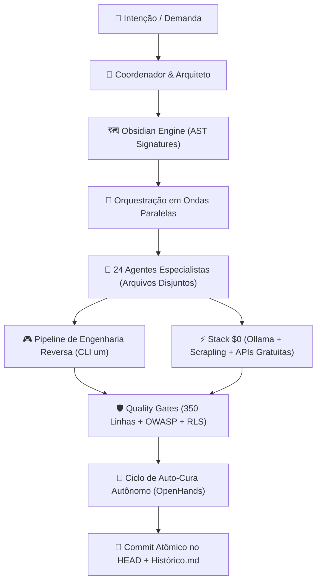

# ⚡ Vibe Engineering Toolkit

**O Mega Toolkit de Engenharia de Agentes, Economia Estrita de Tokens, Quality Gates, Engenharia Reversa e Stack $0.**

Um sistema integrado e unificado que combina:
1. O esquadrão completo de **24 Agentes Especialistas** (desenvolvimento web, backend, mobile, segurança, qa e jogos).
2. A economia extrema de tokens do **Obsidian Engine** com AST local de custo zero.
3. As diretrizes matemáticas de **Orquestração em Ondas Paralelas** e **Quality Gates rígidos** (limite de 350 linhas).
4. O ecossistema de **Engenharia Reversa, Ports Nativos e Modding de Jogos** com automação via CLI `um` (`universal-modder`).
5. A **Stack $0**: Inferência local de IA via Ollama, stealth web scraping via Scrapling, catálogo de APIs gratuitas e ciclo de auto-cura autônomo (OpenHands pattern).

Compatível nativamente com **Claude Code**, **Google Antigravity / Gemini**, **OpenAI Codex** e **OmniRoute Gateway**.

---

## 🏛️ Os Pilares da Engenharia Vibe



### 1. 🧠 Obsidian Engine (Economia de Tokens a Custo Zero)
- **Geração de Codemap Nativa:** Script nativo em Node.js (`codemap_generator.js`) com 0 dependências externas que extrai assinaturas AST de classes, funções, interfaces, types e componentes React (`FC`, `memo`, `forwardRef`, `default exports`).
- **Leitura Cirúrgica de Linhas:** Os agentes nunca varrem a base de código do zero. Eles consultam o `tree-signatures.md` e lêem apenas os blocos de linhas exatos afetados via offsets.
- **Cofre Isolado:** A pasta `.memory/` é automaticamente registrada em `.git/info/exclude`. Seu repositório no GitHub permanece 100% limpo, sem subir lixo de contexto para o time.

### 2. 🌊 Orquestração em Ondas Paralelas (Parallel Wave Dispatch)
- **Eliminação de Colisão de Arquivos:** Subagentes paralelos só rodam na mesma onda se o conjunto de arquivos for estritamente disjunto:
  $$\text{Files}(T_A) \cap \text{Files}(T_B) = \emptyset$$
- **Prevenção de Race Conditions:** Subagentes implementadores **nunca commitam** por conta própria. Eles realizam as alterações na working tree e reportam. Apenas o agente coordenador efetua commits atômicos capturando o `HEAD` fresco.
- **Fail-Safe Automático:** Se o escopo de arquivos de uma tarefa for genérico ou ambíguo, a execução degrada de forma segura para uma onda sequencial isolada.

### 3. 📏 Quality Gates Rígidos & Regra de Ouro das 350 Linhas
- **Limite Máximo de 350 Linhas por Arquivo:** Força modularização real. Nenhum arquivo monstro é permitido.
  - Lógica de estado e mutações $\rightarrow$ **Custom Hooks** (`use<Feature>.ts`).
  - Blocos visuais específicos $\rightarrow$ **Sub-componentes UI** em `components/`.
  - Consultas e chamadas de dados $\rightarrow$ **Services / Repositories**.
- **Isolamento de Camadas (UI vs DB):** Componentes visuais nunca executam queries de banco nem importam clientes SQL diretamente.
- **Tolerância Zero a Warnings:** Burndown contínuo de warnings no ESLint e TypeScript.

### 4. 🎮 Engenharia Reversa, Ports Nativos & Modding (CLI `um`)
- **CLI Unificado `um`:**
  - `um scan`: reconhecimento automático de engine (.NET, Unity IL2CPP, Unreal, Source, C++ nativo), arquitetura, loaders e saves.
  - `um backup`: snapshot e restore atômico de saves antes de injeções.
  - `um win`: automação nativa do Windows para capturas de tela, gravação com áudio do processo (loopback) e injeção de inputs.
  - `um kb search`: busca offline ultrarrápida em mais de 100 notas de campo de engenharia reversa.
  - `um comfy`: geração local de texturas e assets via ComfyUI a custo zero.
- **Pipeline de Descompilação e Recompilação Estática:** Suporte a Ghidra headless, ILSpy, Cpp2IL, objdiff (MWCC matching) e reconstrução de ports para PC (SDL2/CMake).

### 5. ⚡ Stack $0: Inferência Local, APIs Abertas & Auto-Cura
- **Inferência Local via Ollama:** Modelos de linguagem rodando 100% no hardware local (`http://localhost:11434/v1`) com compatibilidade OpenAI. Custo zero de tokens para processamento em lote, regras de jogos, categorização financeira e testes.
- **Web Scraping Indetectável com Scrapling:** Extração com Camoufox de dados públicos e fóruns sem bloqueios por Cloudflare ou Turnstile.
- **Catálogo de APIs Gratuitas e Free-for-Dev:** Mapeamento de APIs abertas (Scryfall para TCG, Open Food Facts para Fitness, Banco Central/AwesomeAPI para Finanças) e arquiteturas de nuvem sem custo mensal (Supabase Free, Cloudflare R2/Workers, Neon, Turso).
- **Ciclo de Auto-Cura Autônomo:** Loop inspirado no OpenHands para detectar diagnósticos de erro em stdout/stderr, aplicar correções pontuais e retestar iterativamente até o sinal verde.

---

## 🚀 Instalação Rápida em 1 Clique

Para instalar ou sincronizar todos os agentes, skills e instruções na sua máquina local:

### Windows (PowerShell):
```powershell
.\scripts\install.ps1
```

### Linux / macOS / WSL:
```bash
chmod +x ./scripts/install.sh
./scripts/install.sh
```

---

## 🤖 Catálogo dos 24 Agentes Especialistas

| Agente | Papel | Quando Invocar |
|---|---|---|
| `arquiteto` | Desenha a arquitetura antes do código (SOLID, Clean Code). | Início de novos projetos ou refatorações complexas. |
| `revisor-codigo` | Audita qualidade, limites de 350 linhas, tipagem e boas práticas. | Obrigatório após qualquer alteração de código. |
| `seguranca` | Especialista em OWASP, RLS do Supabase, auth, tokens e segredos. | Sempre que tocar em rotas, auth, queries ou uploads. |
| `testador` | QA do app: compilação, typecheck e testes funcionais E2E. | Antes de qualquer release ou commit de feature. |
| `pentester` | Testa robustez, injeção de dados maliciosos e superfície de ataque. | Após o teste funcional e antes da aprovação do Tech Lead. |
| `tech-lead` | Árbitro técnico: consolida relatórios, classifica severidades (P0-P3). | Decisão final antes de autorizar deploy ou fechar task. |
| `engenheiro-reversa-jogos`| Especialista em descompilação de consoles (PS2, N64) e PC, ports nativos C/C++, DLL hooking e CLI `um`. | Em projetos de port nativo, emulação, análise de binários ou modding. |
| `mod-orchestrator` | Supervisor geral de projetos de modding e engenharia de jogos. | Ao iniciar ou coordenar projeto completo de modding de jogo. |
| `mod-game-worker` | Operador do jogo: constrói, injeta, testa e captura telemetria ao vivo. | Durante testes e validações em tempo real no jogo. |
| `mod-offline-worker` | Pesquisa offline: estuda formatos, descompila e cria patches em stubs. | Para tarefas de descompilação, análise de binários e formatos sem abrir o jogo. |
| `descoberta-agentes` | Avalia o domínio do projeto e mapeia especialistas necessários. | Início de projeto novo ou entrada em tecnologia nova. |
| `engenheiro-prompts` | Transforma ideias brutas em prompts estruturados para IAs. | No desenho de novas aplicações ou prompts para Lovable. |
| `especialista-mobile` | Revisor de UX/UI responsivo para celular e tablet (375px/768px). | Ao criar ou alterar telas consumidas em mobile/PWA. |
| `especialista-acessibilidade` | Revisa conformidade WCAG 2.1 AA (contraste, teclado, leitores). | Em componentes visuais e formulários de interface. |
| `especialista-electron` | Especialista em apps desktop Electron no Windows (contextBridge). | Em apps Electron e ferramentas desktop locais. |
| `supabase-sql` | Executa e valida SQL, migrations e RLS via API sem browser. | Ao alterar banco de dados, criar tabelas ou policies. |
| `git-workflow` | Conduz o ciclo Git completo: branch, diff, commit, push. | Última etapa de qualquer entrega atômica. |
| `gerador-docs` | Gera documentação clara de engenharia (README, docstrings, POP). | Ao documentar repositórios ou preparar handoffs. |
| `gestor-dependencias` | Audita vulnerabilidades, pacotes órfãos e lockfiles. | Manutenção periódica de dependências do package.json. |
| `analista-custo-nuvem` | Monitora custos de API, egress, Supabase, LLMs e storage. | Ao escalar funcionalidades ou integrar novos modelos de IA. |
| `agente-rollback` | Reverte commits/deploys quebrados com segurança sem force push. | Quando um deploy quebra ou precisa de rollback estável. |
| `auditor-agentes` | Cyber security dos próprios agentes, prompts, skills e hooks. | Ao alterar configurações internas de IA ou settings. |
| `revisor-ia` | Audita prompt injection, vazamentos de contexto e alucinação. | Em features que consomem LLM, OCR ou assistentes. |
| `general-purpose` | Operações gerais e tarefas operacionais sem persona específica. | Tarefas utilitárias cotidianas. |

---

## 🛠️ Catálogo das Skills Globais

1. **`obsidian-engine`:** Motor global de economia de tokens com `codemap_generator.js`, grafo `imports.md` e cofre `.memory/`.
2. **`ollama-local-llm`:** Inferência local a custo zero ($0 tokens) via endpoint OpenAI em `localhost:11434/v1`.
3. **`scrapling-crawler`:** Web scraping de alta velocidade e bypass de Cloudflare/Turnstile com Scrapling & Camoufox.
4. **`catalogo-apis-gratuitas`:** Guia prático de APIs públicas gratuitas (TCG, Fitness, Finanças) e infraestrutura Free-for-Dev ($0).
5. **`ciclo-auto-cura`:** Loop autônomo inspirado no OpenHands para validação e auto-correção de falhas de compilação/testes.
6. **`mcp-catalog`:** Catálogo curado de servidores MCP (Ollama, SQLite, Postgres, Playwright).
7. **`orquestracao-ondas`:** Protocolo matemático de execução de subagentes em ondas paralelas.
8. **`sanitizacao-codigo`:** Pente-fino cirúrgico de código legado com medição antes vs. depois.
9. **`analista-custo-nuvem`:** Análise preditiva de faturas, egress e custo de chamadas de LLM.
10. **`engenharia-reversa-jogos`:** Guia mestre de decompilação, recompilação estática, ports nativos e CLI `um`.
11. **`reverse-engineering`:** Fluxo completo de inspeção de código real (Ghidra, ILSpy, Cpp2IL, Frida, RenderDoc).
12. **`vr-game-modding`:** Conversão de jogos para Realidade Virtual (VR 6DOF), perfis UEVR e injeção OpenXR.
13. **`wasm-game-ports`:** Portabilidade para navegador via WebAssembly, WebGL/WebGPU e File System Access API imune a DMCA.
14. **`game-recon`:** Reconhecimento automático de arquitetura de jogos e mapeamento de rotas de hooking.
15. **`game-automation`:** Automação nativa do Windows (PowerShell/C#) para screenshots, gravação e inputs.
16. **`asset-pipeline`:** Conversão de modelos 3D e texturas em spritesheets e formatos de engine.
17. **`fal-assets`:** Pipeline generativo via Fal.ai para modelos 3D, texturas PBR, áudio e sprites.
18. **`mod-any-game`:** Loop completo de desenvolvimento de mods (intake $\rightarrow$ recon $\rightarrow$ lab $\rightarrow$ verify $\rightarrow$ publish).
19. **`mashup-mods`:** Integração entre engines diferentes via WebSockets, IPC e compositing de profundidade.
20. **`port-a-mod`:** Portabilidade de modificações entre versões de engines ou plataformas.
21. **`publish-mod`:** Verificação pré-lançamento para garantir integridade e ausência de binários proprietários.
22. **`share-field-notes`:** Documentação estruturada de notas de campo para enriquecer a base de conhecimento.
23. **`showcase-video`:** Edição e renderização automatizada de vídeos de demonstração de mods.
24. **`game-research-websearch`:** Pesquisa técnica aprofundada de engines e formatos não documentados.
25. **`atualizar-historico`:** Mantém o `Historico.md` sincronizado a cada ciclo atômico.
26. **`configurar-pwa` & `gerar-icones-pwa`:** Transforma apps web em Progressive Web Apps instaláveis.
27. **`checkup-pc`:** Auditoria de performance, saúde e storage do ambiente de desenvolvimento.
28. **`lovable-economia`:** Otimização e consolidação de prompts em plataformas low-code.
29. **`compliance-privacy`:** Diretrizes de segurança de dados e privacidade em conformidade.

---

## 🌐 Integração com OmniRoute e Monitoramento Remoto

Este toolkit integra-se nativamente com:
- **OmniRoute AI Gateway:** Permite alternar dinamicamente entre Claude Opus, Claude Sonnet, Gemini Pro, GPT-4o e DeepSeek através de gateway unificado.
- **Gêmeo Digital 3D & Dispatch Remoto:** Compatível com visualização 3D de sessões ativas e despacho de tarefas via GitHub Issues.

---

## 📄 Licença
Distribuído sob licença [MIT](LICENSE). Criado e mantido por **Mateus** (`@MateusD12`).
