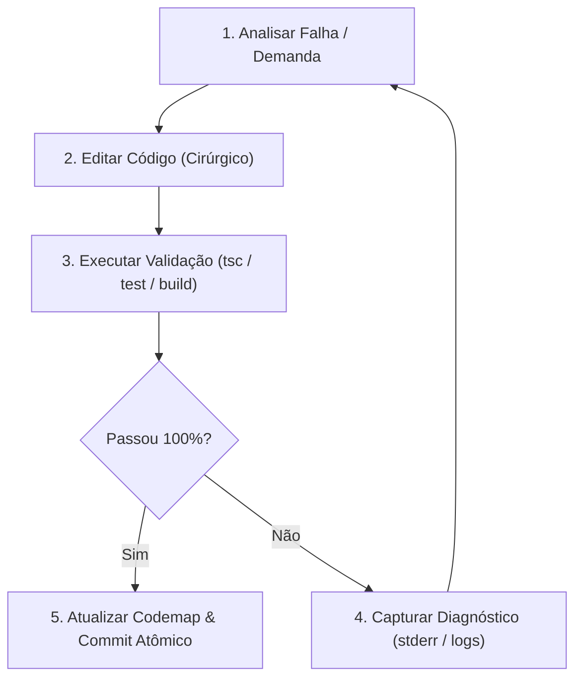

# Ciclo de Auto-Cura de Código (OpenHands Pattern)

Inspirado na arquitetura do **OpenHands** (antigo OpenDevin), este padrão estabelece como o agente resolve problemas e implementa código de forma autônoma e resiliente, fechando o loop entre execução de comandos e correção de código.

---

## 1. O Loop de Auto-Cura (The Autonomous Loop)

### Regras do Loop:
1. **Nunca pergunte sobre erros triviais:** Se um comando falhou (`typecheck`, `syntax error`, `missing import`), leia a saída de erro, vá diretamente na linha afetada e corrija.
2. **Limite de Iterações (Circuit Breaker):** Tente corrigir até **3 iterações**. Se após 3 tentativas o erro persistir na mesma raiz, investigue premissas arquiteturais ou consulte o usuário.
3. **Validação Não Destrutiva:** Nunca comente testes para fazê-los "passar" nem use flags como `--skip-tests` ou `--ignore-errors` sem permissão explícita. O código deve ser corrigido para atender ao teste.

---

## 2. Comandos Padrão de Validação por Stack

| Stack / Linguagem | Comando de Diagnóstico Rápido | Comando de Build Completo |
| :--- | :--- | :--- |
| **TypeScript / React** | `npx tsc --noEmit` | `npm run build` |
| **Python** | `python -m py_compile <arquivo>` | `pytest -x` |
| **C / C++ (CMake)** | `cmake --build build --target <alvo>` | `ctest --output-on-failure` |
| **Rust** | `cargo check` | `cargo test` |
| **Go** | `go vet ./...` | `go test ./...` |

---

## 3. Heurísticas de Resolução de Erros

1. **Missing Module / Cannot find module:**
   - Verifique `package.json` ou `pyproject.toml`.
   - Se o pacote existe no ecossistema e é livre de malwares, instale via `npm install <pkg>` ou `uv pip install <pkg>`.
2. **Type mismatch / Property does not exist:**
   - Inspecione a interface/tipo original no arquivo de definições antes de fazer `any` ou `as unknown`.
   - Adapte a assinatura de forma tipada e coesa.
3. **Port already in use (EADDRINUSE):**
   - Identifique e mate o processo zumbi em background (`taskkill /F /PID <pid>`) antes de tentar subir o servidor novamente.
