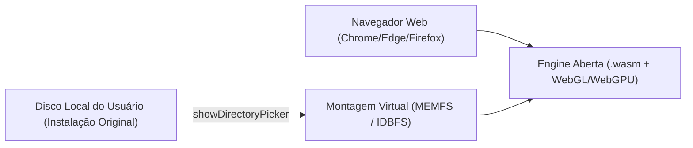

# Ports de Jogos para Navegador via WebAssembly & WebGPU

Guia mestre para compilar motores de jogos descompilados, ports nativos (C/C++, Rust, Zig) e recompilações estáticas para execução direta em qualquer navegador web moderno sem plugins ou servidores externos.

---

## 1. Arquitetura Clean-Room (100% Imune a DMCA)

A maior causa de derrubada jurídica de ports (Take-Two, Nintendo, Activision) é a distribuição indevida de binários protegidos por direitos autorais, texturas, áudio ou modelos 3D originais.

### O Modelo Limpo:


1. **O Repositório / Site Web distribui APENAS:**
   - O código do motor reimplementado ou descompilado e compilado em WebAssembly (`engine.wasm`).
   - O player HTML/JavaScript e shaders genéricos.
2. **O Usuário Fornece os Assets:**
   - Ao abrir a página pela primeira vez, o navegador solicita acesso à pasta onde o jogo original está instalado na máquina através da **File System Access API**:
     ```javascript
     const dirHandle = await window.showDirectoryPicker();
     ```
   - O JavaScript lê os arquivos proprietários (`.dat`, `.pak`, `.wav`, `.mp3`, texturas) diretamente do disco e monta na memória do Emscripten (`FS.createDataFile`).
   - **Resultado:** Zero violação de copyright, zero dependência de servidores de streaming.

---

## 2. Toolchain de Compilação: C/C++ via Emscripten (`emcc`)

Para compilar projetos que utilizam SDL2, CMake e C++ moderno:

### Configuração de Flags Essenciais:
```bash
emcc \
  -O3 \
  -msimd128 \
  -s USE_SDL=2 \
  -s USE_SDL_IMAGE=2 \
  -s USE_SDL_MIXER=2 \
  -s MAX_WEBGL_VERSION=2 \
  -s ALLOW_MEMORY_GROWTH=1 \
  -s INITIAL_MEMORY=256MB \
  -s STACK_SIZE=8MB \
  -s EXPORTED_RUNTIME_METHODS='["FS", "cwrap", "ccall"]' \
  -s NO_DISABLE_EXCEPTION_CATCHING \
  -o public/game.js
```

### Otimizações Críticas:
- **`-msimd128`:** Ativa instruções vetoriais SIMD no WebAssembly para física e matrizes gráficas.
- **Multithreading (Pthreads / Web Workers):**
  - Flags: `-pthread -s PTHREAD_POOL_SIZE=4`
  - Requer que o servidor HTTP envie os cabeçalhos de isolamento de contexto cruzado (*Cross-Origin Opener Policy* e *Embedder Policy*):
    ```http
    Cross-Origin-Opener-Policy: same-origin
    Cross-Origin-Embedder-Policy: require-corp
    ```

---

## 3. Renderização Gráfica: WebGL 2.0 vs. WebGPU

1. **WebGL 2.0 (Equivalente ao OpenGL ES 3.0):**
   - Máxima compatibilidade com navegadores legados e dispositivos móveis (Android / iOS).
   - Suporte direto através da camada de emulação do SDL2 e GLES3 do Emscripten.
2. **WebGPU (A Nova Geração):**
   - Para projetos reconstruídos em **Rust** (usando `wgpu`) ou ports que exigem pipelines de computação (Compute Shaders).
   - Comunicação direta com DirectX 12 (Windows), Metal (macOS) e Vulkan (Linux/Android) através do browser, com mínima sobrecarga de CPU.

---

## 4. Pipeline de Áudio: Web Audio API & AudioWorklet

Jogos clássicos utilizam callbacks de áudio de baixa latência em threads separadas:
- O Emscripten mapeia o subsistema de áudio do SDL2 diretamente para `AudioContext`.
- Em navegadores modernos, a reprodução de áudio só pode iniciar após um gesto do usuário (clique ou toque de tecla na tela inicial). O engine deve aguardar o primeiro input antes de desmutar o contexto.

---

## 5. Checklist de Entrega de um Port Web

1. **Verificação de Isolamento:** Garantir que nenhum arquivo binário proprietário subiu para o repositório Git.
2. **Teste de Leitura Local:** Testar o carregamento da pasta original do jogo via drag-and-drop ou seletor de diretório nativo.
3. **Persistência de Saves:** Salvar o progresso do jogador (slots de save) no `IndexedDB` do navegador via `FS.syncfs(true, callback)`.
